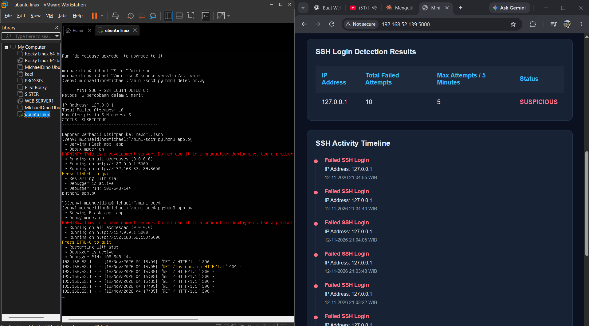
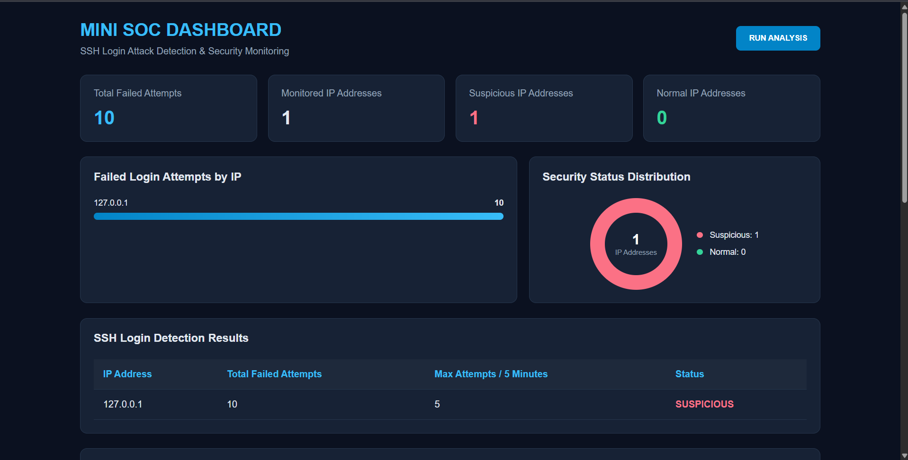

A Python-based Security Operations Center (SOC) monitoring project that analyzes SSH authentication logs to detect suspicious login attempts and potential brute-force attacks.
Mini SOC is a lightweight cybersecurity monitoring tool developed using Python and Flask.

The system analyzes SSH authentication logs from an Ubuntu Linux environment, identifies failed login attempts, and detects suspicious activity based on a configurable threshold within a specific time window.

The analysis results are displayed through a web-based dashboard, allowing users to monitor SSH login activity, view statistics, and identify potentially suspicious IP addresses.
- SSH Log Monitoring: Reads SSH authentication logs from Ubuntu Linux.
- Failed Login Detection: Identifies unsuccessful SSH login attempts.
- Brute-Force Detection: Detects suspicious login patterns based on a configurable threshold.
- Time-Based Analysis: Counts login attempts within a five-minute window.
- IP Address Analysis: Groups failed login attempts by source IP address.
- JSON Reporting: Generates analysis results in JSON format.
- Web Dashboard: Displays monitoring statistics and charts.
- SSH Activity Timeline: Shows recent SSH authentication events.
- WIB Time Display: Converts event timestamps to Western Indonesian Time (UTC+7).

| Technology | Purpose |
|---|---|
| Python 3 | Main programming language |
| Flask | Web dashboard framework |
| Ubuntu Linux | Operating system and SSH log source |
| Regular Expressions | Extracting IP addresses and log events |
| JSON | Storing analysis results |
| HTML & CSS | Dashboard interface |
| JavaScript / Chart.js | Dashboard charts |


```text
Ubuntu Linux
     |
     v
SSH Authentication Logs
     |
     v
detector.py
     |
     v
Log Analysis & IP Grouping
     |
     v
Brute-Force Detection
(5 attempts within 5 minutes)
     |
     v
report.json
     |
     v
app.py (Flask)
     |
     v
Web-Based SOC Dashboard
     |
     v
Statistics, Charts & Activity Timeline
```

```bash
git clone YOUR_GITHUB_REPOSITORY_URL
cd mini-soc
```

Replace `YOUR_GITHUB_REPOSITORY_URL` with your actual GitHub repository URL.


```bash
python3 -m venv venv
```

```bash
source venv/bin/activate
```
```bash
pip install -r requirements.txt
```
The application reads SSH authentication logs from:

```text
logs/auth.log
```

On Ubuntu, the original authentication log is generally located at:

```text
/var/log/auth.log
```

Copy the log into the project directory:

```bash
sudo cp /var/log/auth.log ~/mini-soc/logs/auth.log
```

Adjust file ownership so the application can read it:

```bash
sudo chown "$USER":"$USER" ~/mini-soc/logs/auth.log
```

Note: Access to authentication logs may require administrator privileges.

```bash
cd ~/mini-soc
source venv/bin/activate
```
```bash
python3 detector.py
```

The detector analyzes the authentication log and generates:

```text
report.json
```
```bash
python3 app.py
```
Open a browser and visit:

```text
http://127.0.0.1:5000
```

For access from another device on the same network, use the Ubuntu VM's IP address and port 5000.

The detector uses a configurable threshold and time window:

| Parameter | Value |
|---|---|
| Detection threshold | 5 failed attempts |
| Time window | 300 seconds |
| Detection method | Sliding time window |
| Analysis target | SSH failed login attempts |
| Classification | NORMAL / SUSPICIOUS |

An IP address is classified as **SUSPICIOUS** when it generates at least five failed SSH login attempts within a five-minute window.

Otherwise, it is classified as **NORMAL**.

This classification indicates suspicious activity and does not independently confirm a successful attack.

The system was tested using failed SSH login attempts in an Ubuntu virtual machine.

Example test result:

```text
===== MINI SOC - SSH LOGIN DETECTOR =====
Metode: 5 percobaan dalam 5 menit

IP Address: 127.0.0.1
Total Failed Attempts: 10
Max Attempts in 5 Minutes: 5
STATUS: SUSPICIOUS
---------------------------------------

Laporan berhasil disimpan ke: report.json
```

The detector successfully identified five failed login attempts within a five-minute window and classified the source IP address as suspicious.


## Dashboard Preview

### Dashboard Overview



### SSH Activity Timeline




- The current implementation focuses on SSH failed login events.
- Detection depends on the availability and format of authentication logs.
- The system identifies suspicious activity but does not automatically block IP addresses.
- The Flask development server is intended for local educational testing, not production deployment.

This project demonstrates practical experience in:

- Linux system administration.
- SSH authentication log analysis.
- Python programming and automation.
- Basic cybersecurity monitoring.
- Brute-force attack detection concepts.
- Flask web application development.
- Security event reporting and visualization.
Developed as a practical cybersecurity learning project using Python, Flask, and Ubuntu Linux.
